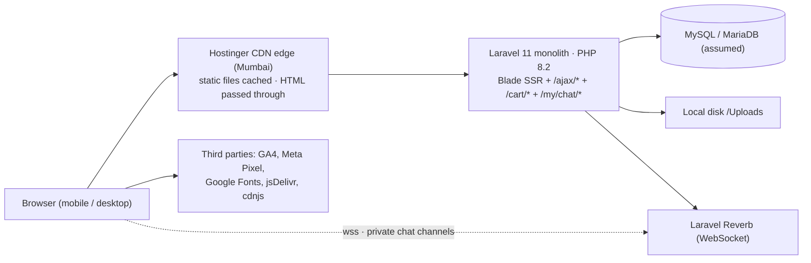
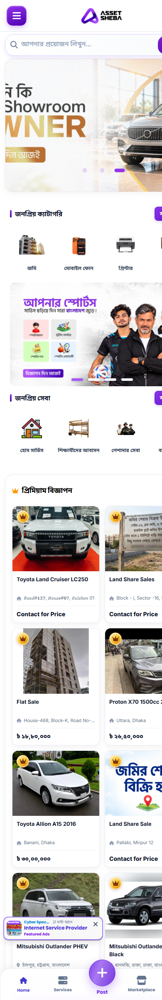
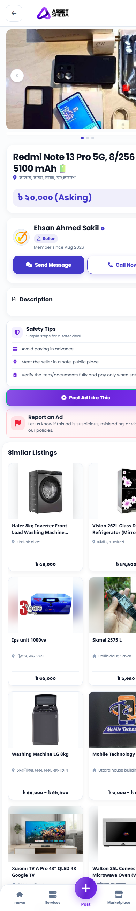
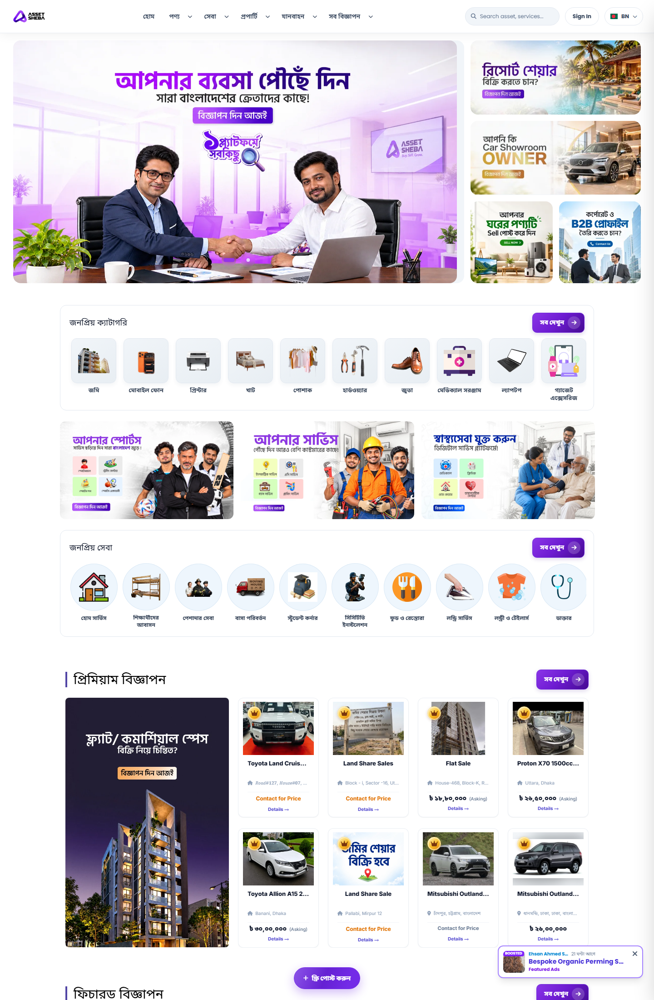
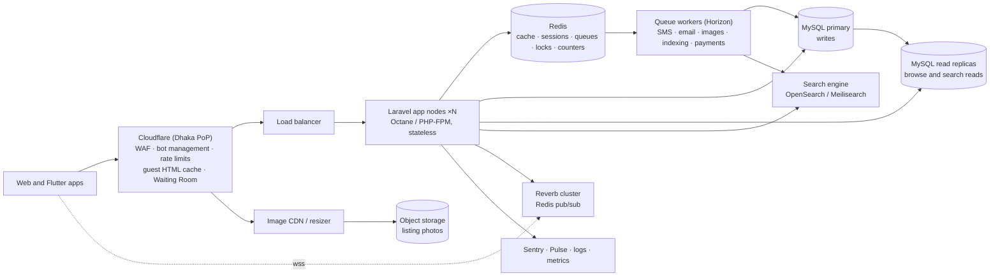

# Asset Sheba: Technical Assessment of assetsheba.com

**Prepared by:** Shahin Sheikh, for the Senior Software Engineer interview at Asset Sheba Ltd.
**Review date:** 15 November 2026
**Scope:** the public website https://assetsheba.com (unauthenticated, non-intrusive review)
**Proposed role:** Tech Lead, with a team of 5 junior developers (see [section 9](#9-my-proposal-as-tech-lead-team-stack-and-estimate))
**Availability:** 5-day work week (not 6 days)

---

## Contents

1. [Executive summary](#1-executive-summary)
2. [Scope and methodology](#2-scope-and-methodology)
3. [Technology stack (as observed)](#3-technology-stack-as-observed)
4. [Findings](#4-findings)
   - 4.1 [Security](#41-security)
   - 4.2 [Bugs and functional issues](#42-bugs-and-functional-issues)
   - 4.3 [Performance](#43-performance)
   - 4.4 [SEO](#44-seo)
   - 4.5 [UI/UX and mobile](#45-uiux-and-mobile)
   - 4.6 [API design](#46-api-design)
   - 4.7 [Architecture and system design](#47-architecture-and-system-design)
5. [Prioritised roadmap and how I would approach the fixes](#5-prioritised-roadmap-and-how-i-would-approach-the-fixes)
6. [Scaling plan for mega campaigns](#6-scaling-plan-for-mega-campaigns)
7. [Managing a growing database](#7-managing-a-growing-database)
8. [Answers to the additional questions](#8-answers-to-the-additional-questions)
9. [My proposal as Tech Lead: team, stack and estimate](#9-my-proposal-as-tech-lead-team-stack-and-estimate)
10. [Appendix: raw measurements](#10-appendix-raw-measurements)

---

## 1. Executive summary

The platform has a solid base: modern Laravel on PHP 8.2, TLS 1.3, correct cookie flags, CSRF protection, sitemaps, WebP images, long-lived caching of versioned static files, and a clean Bengali-first card UI. Sensitive files (`.env`, `.git`, logs) are correctly blocked.

The problems sit in four areas:

1. **Privacy and revenue leak.** Seller phone numbers and emails are already in the page source for every visitor. The paid "reveal contact" step only un-hides them, so it can be bypassed with View Source, and every seller's contacts can be scraped.
2. **Mobile experience.** At a 390 px phone width the content is wider than the screen (buttons, prices and cards are clipped), and three quick links in the mobile hero return 404.
3. **Nothing is cached at the edge.** Every guest page view runs PHP and creates a session. Pages are 330 to 580 KB of HTML with roughly 1.1 MB of CSS and JS behind them. This is the main blocker for surviving a mega campaign.
4. **Foundations for growth.** There is no structured data for SEO, no versioned API (which a Flutter app needs), user uploads are served from the main domain, and many endpoints are RPC-style calls that return HTML fragments.

### Top 10: what I would fix first

| # | Priority | Issue | Area | Effort |
|---|---|---|---|---|
| 1 | **P0** | Seller phone and email pre-rendered in HTML, so the paid "reveal contact" is bypassable and all seller contacts can be scraped ([S-1](#s-1--p0--seller-contact-details-are-in-the-page-source)) | Security, revenue | S |
| 2 | **P0** | `/ajax/check-identifier` reveals whether a phone or email is registered and returns the name and avatar before login ([S-2](#s-2--p0--account-enumeration-and-personal-data-before-login)) | Security, privacy | S |
| 3 | **P0** | `X-Frame-Options: ALLOWALL` and `frame-ancestors *` let any website iframe logged-in pages (clickjacking) ([S-3](#s-3--p0--clickjacking-framing-is-explicitly-allowed-for-every-site)) | Security | XS |
| 4 | **P0** | Horizontal overflow on phones, plus 3 broken (404) quick links in the mobile hero ([B-1, B-2](#42-bugs-and-functional-issues)) | UX, bug | S |
| 5 | **P1** | `/ajax/file-load` renders a server template whose name comes from the browser ([S-4](#s-4--p1--ajaxfile-load-renders-a-template-chosen-by-the-browser)) | Security | S |
| 6 | **P1** | No edge caching of HTML, and a session is created for every anonymous visitor ([P-1](#43-performance)) | Scale, performance | M |
| 7 | **P1** | 583 KB homepage HTML, 424 KB CSS, 21 unbundled scripts, every modal shipped in the first load ([P-2 to P-5](#43-performance)) | Performance | M |
| 8 | **P1** | No JSON-LD on any page; homepage and category pages lack meta description, canonical and Open Graph tags ([SEO-1, SEO-2](#44-seo)) | SEO | S |
| 9 | **P1** | User uploads served from the main origin; listing images have no responsive sizes ([S-6](#s-6--p1--user-uploads-are-served-from-the-main-origin), [P-7](#43-performance)) | Security, performance | M |
| 10 | **P2** | No versioned API and RPC-style endpoints, which blocks a Flutter app and partner integrations ([4.6](#46-api-design)) | API, architecture | L |

**Priority:** P0 = this week, P1 = next 2 to 4 weeks, P2 = this quarter, P3 = backlog.
**Effort:** XS = under half a day, S = up to 2 days, M = up to 2 weeks, L = more than 2 weeks.

### My proposal in brief

- **Role and team:** I lead the work as a hands-on Tech Lead with 5 junior developers.
- **Timeline:** P0 fixes live within the first 2 weeks; new cloud infrastructure by week 12; campaign-ready by week 20; Flutter app in the stores around week 26. The whole plan is about 6 months of 5-day weeks, including contingency.
- **Preferred stack:** Laravel (modular monolith) and Blade with Alpine.js and Vite for the web, Flutter for mobile, MySQL, Redis and OpenSearch, running on AWS Mumbai (ap-south-1) behind Cloudflare.
- **Working week:** I'm available for a 5-day work week, not 6 days. The estimate is planned on that basis.

Details are in [section 9](#9-my-proposal-as-tech-lead-team-stack-and-estimate).

---

## 2. Scope and methodology

- **Approach:** a passive, unauthenticated review of the public site on 15 November 2026. About 150 HTTP requests in total, spaced out at normal browsing speed.
- **Tools:** `curl` for headers, status codes, redirects and timing; static analysis of the HTML, JS and CSS; sitemap counts; OpenSSL for TLS; headless Microsoft Edge screenshots at 390 px (phone) and 1440 px (desktop).
- **Not done, by design:** no login or registration, no OTP or payment flows, no form submissions, no fuzzing or exploitation, no load testing. Findings inferred from client-side code are marked **"verify server-side"**.
- **Personal data:** phone numbers and emails seen during the review are redacted in this report.
- **Lighthouse:** I could not run it. Hostinger's bot challenge returns HTTP 403 to headless Lighthouse, and the public PageSpeed Insights API quota was used up that day. Lab and field Core Web Vitals can be added in about a minute from https://pagespeed.web.dev. The issues in [4.3](#43-performance) are the ones I would expect it to flag.

---

## 3. Technology stack (as observed)

**Confidence:** ✅ confirmed from headers or code · 🔎 strong inference · ❔ assumption

### Backend

| Layer | Technology | Evidence | Conf. |
|---|---|---|---|
| Language | PHP 8.2.35 | `X-Powered-By: PHP/8.2.35` header | ✅ |
| Framework | Laravel 11 or later | Encrypted `XSRF-TOKEN` and `asset_sheba_session` cookies, `csrf-token` meta tag, the `/up` health route (introduced in Laravel 11), `/broadcasting/auth` | ✅ |
| Rendering | Server-side Blade templates, plus HTML fragments loaded over AJAX | `data-file-load-path="frontend.partials.nav"` (Blade dot notation) | ✅ |
| Real-time | Laravel Reverb (WebSockets) with Laravel Echo and pusher-js; polling fallback | `broadcaster: 'reverb'` and private `chat.user.{id}` channels in `chat-modal.js` | ✅ |
| Authentication | Session cookie auth; identifier-first login by phone (+880) or email; OTP password reset; social login | `auth-modal.js`, `social-login.js`, `/social/disconnect/{provider}` | ✅ |
| Database | MySQL or MariaDB | Hostinger and Laravel default; not visible externally | ❔ |
| File storage | Local disk, public `/Uploads/...` folder, images converted to WebP | `/Uploads/listings/image/Image-<timestamp>-<random>.webp` | ✅ |
| Business modules | Listings (products, services, vehicles and property), stores and sellers, cart and checkout, subscriptions (contact reveal, chat access), boosted ads (premium, featured, urgent), chat, compare, favourites, ad leads (brand campaigns, affiliates), blog, careers, business portfolios, guest location | Routes referenced in JS and the sitemaps | ✅ |

### Frontend

| Concern | Technology | Notes |
|---|---|---|
| Architecture | Multi-page app (server-rendered) with jQuery 3.7.1 for interactivity | 21 separate `<script>` files on the homepage. No bundler (`/build/manifest.json` returns 404); cache busting is done with `?v=<timestamp>` |
| CSS | Tailwind CSS v4.3.3 (compiled), plus 19 inline `<style>` blocks per page | `homepage.css` is 424 KB uncompressed |
| UI plugins | Slick carousel, SweetAlert2 v11, Select2 4.1.0-rc.0 (with Bootstrap 5 theme), lightGallery (zoom, thumbnails), lazysizes, flag-icons 7.2.3 | Mix of self-hosted files and jsDelivr/cdnjs |
| Icons and fonts | Font Awesome 6.5.1 (full `all.min.css`); Google Fonts: Inter, Poppins, Great Vibes, Noto Sans Bengali | 4 font families, about 20 weights |
| Internationalisation | `<html lang="bn">`; a bn/en switcher on the same URLs | No `hreflang` |
| Theming | Dark mode is built into the CSS and markup but force-disabled by an inline script | About 650 `dark:` classes per page |
| Browser APIs | Web Notifications, Web Audio (chat sounds), localStorage | |
| Analytics | Google Analytics 4 (gtag), Meta Pixel | |

### Infrastructure

| Concern | Observed |
|---|---|
| Hosting | Hostinger (`platform: hostinger`, `panel: hpanel` headers) |
| CDN and edge | Hostinger CDN (`Server: hcdn`). Requests were served from the Mumbai edge (`mum-edge*` request IDs). HTTP/3 advertised. "Checking your browser" bot challenge |
| Caching | Static files: `Cache-Control: public, max-age=2592000` (30 days) ✔. HTML and JSON: `no-cache, private`, with `x-hcdn-cache-status: DYNAMIC` (never cached) |
| TLS | Let's Encrypt certificate, valid until 28 December 2026. TLS 1.3 negotiated; TLS 1.1 refused |
| Redirects | HTTP to HTTPS (301); `www` to the bare domain (301) |
| SEO infrastructure | `robots.txt` and a sitemap index: pages (15 URLs), taxonomy (234), stores and sellers (1,457), blogs (4), listings (1,844). Google Search Console is verified |

### Current architecture (inferred)



---

## 4. Findings

### 4.1 Security

#### S-1 · P0 · Seller contact details are in the page source

- **What happens:** listing and seller pages contain a hidden "Phone & WhatsApp" modal and an email modal with the seller's real phone number and email address. They are rendered for every visitor, including logged-out users and bots. Clicking reveal calls `POST /subscription/reveal-contact`, but on success the script only opens the modal that is already in the page (`openCustomModal(targetModal)`). The response does not carry the contact data.
- **Evidence:** `/listing/details/redmi-note-13-pro-5g-8256-5100-mah-43` and `/seller/<username>` contain the seller's full number in `tel:` and `wa.me` links and the email in plain text (redacted here).
- **Impact:**
  - **Revenue:** anyone can bypass the subscription or contact-reveal gate with View Source.
  - **Privacy:** the sitemap lists 1,844 listings and 1,457 seller pages, so a script can collect every seller's phone and email in minutes. That feeds spam, scam calls and competitor poaching.
  - **Data quality:** reveal analytics undercount real contact.
- **Fix:**
  1. Render only a masked number server-side (for example `017•• ••• •48`).
  2. Return contact data only from the reveal endpoint, after server-side checks: authenticated user, entitlement or quota, per-user rate limit, and an audit log.
  3. Make the endpoint idempotent so reopening a contact does not use up quota.
  4. Add a challenge (for example Cloudflare Turnstile) when one account reveals an unusual number of contacts.

```php
// routes/web.php
Route::post('/listings/{listing}/contact-reveal', RevealContactController::class)
    ->middleware(['auth', 'throttle:contact-reveal']);

// AppServiceProvider::boot()
RateLimiter::for('contact-reveal', fn (Request $r) => Limit::perMinute(10)->by($r->user()->id));

// app/Http/Controllers/RevealContactController.php
public function __invoke(Request $request, Listing $listing): JsonResponse
{
    Gate::authorize('reveal-contact', $listing);              // subscription / quota check

    ContactReveal::firstOrCreate(                              // idempotent: reopening is free
        ['user_id' => $request->user()->id, 'listing_id' => $listing->id],
        ['ip' => $request->ip()]
    );

    return response()->json([
        'phones' => $listing->seller->contactPhones(),         // contact data leaves the server only here
        'email'  => $listing->seller->contact_email,
    ]);
}
```

#### S-2 · P0 · Account enumeration and personal data before login

*(Verify server-side: inferred from `auth-modal.js`.)*

- **What happens:** the identifier-first login posts `{identifier, country_code: "+880"}` to `/ajax/check-identifier`. The client code reads `res.exists`, `res.user_name` and `res.avatar_url` before any password or OTP is entered.
- **Impact:** anyone can type any phone number and learn whether it is registered, along with the person's name and profile photo. That enables doxxing, targeted phishing ("Hi \<name\>, your Asset Sheba ad…") and lists of sellers to target with scams.
- **Fix:**
  - Never return the name or avatar before authentication.
  - Prefer the same response for existing and new identifiers (for example "We've sent a code to …"), and branch after OTP verification.
  - At a minimum, strip the personal data and add throttling per IP and per identifier (for example 5 per minute and 20 per day), with a Turnstile challenge after 3 attempts. Alert on spikes.

#### S-3 · P0 · Clickjacking: framing is explicitly allowed for every site

- **Evidence:** every application response includes `x-frame-options: ALLOWALL` and `content-security-policy: frame-ancestors *`.
- **Impact:** a malicious page can load assetsheba.com invisibly in an iframe and trick a logged-in user into clicking "Post", "Boost", "Pay" or "Delete", or into changing settings.
- **Fix (XS):** send `Content-Security-Policy: frame-ancestors 'self'` (add named partner domains if an embed is needed) and `X-Frame-Options: SAMEORIGIN`. Remove the current values wherever they are set (probably `.htaccess`, hPanel or a middleware).

#### S-4 · P1 · `/ajax/file-load` renders a template chosen by the browser

*(Verify server-side.)*

- **Evidence:** `GET /ajax/file-load` is sent with a Blade view name taken from the HTML attribute `data-file-load-path` (`frontend.partials.nav`, `frontend.partials.languages`, `frontend.sections.home-popular.index`). Any `data-param-*` attributes are forwarded as request parameters. The `{success, html}` response is injected with `$wrapper.html(res.html)`.
- **Risk:** if the controller passes the request value straight to `view()`, an attacker can render any template (admin partials, email templates, invoices) with variables they control. That leads to information disclosure, errors that reveal internals, and HTML injection through `.html()`.
- **Fix:** replace it with a fixed allow-list of named fragments and validate the parameters. Better still, render the nav and language switcher in the page itself, which also removes an extra request from every page view ([P-6](#43-performance)).

```php
final class FragmentController
{
    private const FRAGMENTS = [
        'nav'          => 'frontend.partials.nav',
        'languages'    => 'frontend.partials.languages',
        'home-popular' => 'frontend.sections.home-popular.index',
    ];

    public function __invoke(string $key): JsonResponse
    {
        abort_unless(isset(self::FRAGMENTS[$key]), 404);

        // Only cache fragments that do not depend on the logged-in user.
        $html = Cache::remember("fragment:{$key}:" . app()->getLocale(), 300,
            fn () => view(self::FRAGMENTS[$key])->render());

        return response()->json(['html' => $html]);
    }
}
```

#### S-5 · P1 · Missing security headers and version disclosure

- **Missing from application responses:** `Strict-Transport-Security`, `X-Content-Type-Options: nosniff`, `Referrer-Policy`, `Permissions-Policy`, and a script `Content-Security-Policy`. Hostinger's own challenge page sends several of these; the application does not.
- **Version disclosure:** `X-Powered-By: PHP/8.2.35` advertises the exact PHP version. Set `expose_php = Off` in `php.ini`.
- **Script CSP:** each page has about 15 inline scripts. Start with `Content-Security-Policy-Report-Only` and nonces (`Vite::useCspNonce()`), move inline JS into modules, then enforce the policy.

```php
// app/Http/Middleware/SecurityHeaders.php  (register with $middleware->append(...) in bootstrap/app.php)
public function handle(Request $request, Closure $next): Response
{
    $response = $next($request);
    $response->headers->set('Strict-Transport-Security', 'max-age=31536000; includeSubDomains');
    $response->headers->set('X-Content-Type-Options', 'nosniff');
    $response->headers->set('X-Frame-Options', 'SAMEORIGIN');
    $response->headers->set('Referrer-Policy', 'strict-origin-when-cross-origin');
    $response->headers->set('Permissions-Policy', 'camera=(), microphone=(), geolocation=(self)');
    $response->headers->set('Content-Security-Policy', "frame-ancestors 'self'; upgrade-insecure-requests");
    return $response;
}
```

#### S-6 · P1 · User uploads are served from the main origin

- **Risk:** `/Uploads/...` shares an origin with the session cookie. If any upload path accepts SVG, HTML or a mislabelled file, that becomes stored XSS on assetsheba.com. Directory listing is correctly disabled.
- **Fix:**
  - Move uploads to object storage (S3, Cloudflare R2 or DigitalOcean Spaces) on a separate domain that carries no cookies.
  - Re-encode every image server-side and strip EXIF data. GPS tags in a property photo can reveal a seller's home; the WebP conversion probably strips them already, but verify.
  - Check file types by their content (magic bytes), not just the extension, and enforce size limits.
  - Make sure the web server never executes scripts inside upload folders.

#### S-7 · P1 · Abuse controls on OTP and public write endpoints

*(Recommendation; not tested.)*

- **OTP:** SMS OTP for registration and password reset is the most common target for SMS-pumping fraud, and every message costs money. Use per-phone and per-IP throttles, OTP expiry of 5 minutes or less, at most 5 attempts, exponential back-off, a Turnstile check before "send code", and alerts on SMS cost spikes.
- **Public write endpoints:** rate-limit unauthenticated writes such as `/location/save-guest-location`, `/ajax/favorite/toggle`, `/compare/toggle`, `/ad-leads/*` and `/ajax/register`.
- **Limit by identity, not only IP:** use user, session or phone. Bangladeshi mobile operators put many customers behind carrier-grade NAT (shared IPs), so IP-only limits block real buyers at peak times.

#### Other security observations

| ID | Finding | Fix | Priority |
|---|---|---|---|
| S-8 | Hostinger's bot challenge triggered after about 25 quick asset requests and blocks headless Lighthouse. It helps against scrapers, but it is IP-based, which is risky with carrier-grade NAT during campaigns. It also blocks uptime monitors and SEO tools | Tune thresholds, allow-list monitoring tools, and move to per-endpoint application limits plus proper bot management | P2 |
| S-9 | Third-party CSS and JS load from jsDelivr and cdnjs without Subresource Integrity. Select2 is a release candidate (4.1.0-rc.0) | Bundle and self-host with Vite, or add `integrity` and `crossorigin`; pin stable versions | P2 |
| S-10 | Debug `console.log` output in production JS (chat connection messages) | Strip in the build step | P3 |
| S-11 | `/login` and `/register` are crawlable duplicates of `/sign-in` and `/sign-up` (robots.txt blocks only the latter) | 301 redirects to one canonical route | P3 |
| S-12 | The site runs PHP 8.2, whose security support ends on 31 December 2026, about 6 weeks after this review. After that, PHP security holes will no longer be patched | Upgrade to PHP 8.4 or newer (and the current Laravel major), tested on staging first | P1 |

**Already done well:** TLS 1.3 with legacy TLS refused; HTTPS enforced; session cookie is `HttpOnly`, `Secure` and `SameSite=Lax`; CSRF tokens on POST requests; `.env`, `.git`, `phpinfo.php` and `storage/logs` return 403; no Telescope, Debugbar or Horizon exposed; CORS is not open (no `Access-Control-Allow-Origin`); proper 404 status codes.

---

### 4.2 Bugs and functional issues

| ID | Priority | Bug | Evidence | Fix |
|---|---|---|---|---|
| B-1 | **P0** | Mobile hero quick links return 404 | `/sell`, `/explore?type=products` and `/explore?type=vehicles` (inside `#mobile-home-search-slot`) all return 404. The working routes are `/post-free-add`, `/listings/products` and `/listings/explore/...` | Fix the links. Add a link checker (lychee) to CI and monitor 404s |
| B-2 | **P0** | Content is wider than a phone screen (horizontal overflow) | At 390 px the search button, "সব দেখুন" buttons, price box, "Call Now" button, safety-tips text and the right column of listing grids are clipped, while the fixed header and bottom bar fit (see [screenshots](#45-uiux-and-mobile)). Observed in headless Edge; confirm on a real device | Find the offending element (`100vw` plus padding, fixed widths, flex or grid children without `min-width: 0`). Add Playwright visual tests at 360, 390 and 414 px |
| B-3 | P1 | Changing a listing title breaks its URL | `/listing/details/WRONG-SLUG-43` returns 404 even though listing 43 exists | Resolve by ID and 301-redirect to the current slug. This protects links already shared on Facebook and WhatsApp |
| B-4 | P1 | Empty "Description" card is shown | The listing page shows the section header with no text | Hide empty sections; require a minimum description in the posting wizard |
| B-5 | P2 | Location text repeats itself | "সাভার, ঢাকা, ঢাকা, বাংলাদেশ" (district and division are both Dhaka) | Remove duplicate levels in the location formatter |
| B-6 | P2 | Broken Bengali slugs | `rpgngj-3-bgh-60-kth-kmrsyl-jm-bkry-28` (vowels dropped); the blog post "এসেট সেবা কি?" became `/blogs/seterg` | Proper Bengali-to-Latin transliteration, or Unicode slugs; make slugs editable in admin |
| B-7 | P2 | Spaces and `&` in URLs | `/taxonomy/department/Electronics%20&%20Technology/categories`, `/taxonomy/functionality/vehicles&property`; image files such as `Slider-1 Left.webp` and `Car Right Slider-2.webp` | Slugify taxonomy and file names; 301-redirect the old URLs |
| B-8 | P2 | `/index.php` serves the homepage with status 200 | Duplicate URL for the homepage | 301-redirect to `/` |
| B-9 | P3 | Dead dark-mode code | An inline script forces the light theme, yet each page carries about 650 `dark:` classes and the CSS has about 1,300 dark-variant selectors | Either ship dark mode or delete it |
| B-10 | P3 | Inconsistent route names | `/sign-in` and `/login`; `/store/{slug}` and `/seller/{username}`; `/post-free-add` (should be "ad"); `/listings/explore` works but `/explore` returns 404 | Pick one URL convention and redirect the others |

---

### 4.3 Performance

**Measurements**

| Metric | Value | Comment |
|---|---|---|
| Homepage HTML size | 583 KB raw / 85 KB gzipped | Target under 100 KB raw |
| Inner page HTML size | 330 to 473 KB raw | The listing page is 473 KB |
| 404 page | 306 KB | Bots hit 404s often; this should be a few KB |
| Time to first byte (my connection) | 0.3 to 0.7 s | Origin processing time is 0.19 to 0.27 s (`x-hcdn-upstream-rt`) |
| HTML cached at the edge | Never (`DYNAMIC`, `no-cache, private`, session cookie set) | |
| DOM elements (approx.) | About 2,000 (home), about 1,500 (listing) | |
| Inline CSS / inline JS (homepage) | 120 KB / 114 KB | Cannot be cached; downloaded again on every page |
| Script files | 21 on the homepage, 24 on the listing page | Not bundled; about 690 KB of raw JS in total |
| Main stylesheet | 424 KB raw / 50 KB gzipped | Tailwind build including dark-mode rules |

**Findings**

| ID | Priority | Issue | Fix |
|---|---|---|---|
| P-1 | **P1** | No HTML caching, and every guest gets a session. Each anonymous page view goes all the way to PHP and the database | Cache guest HTML at the edge (`s-maxage=60, stale-while-revalidate=600`), skipping the cache when the session cookie is present. Stop starting sessions for guests on public GET routes, fetch the CSRF token only when a form opens, and personalise the header for logged-in users with a small `/api/v1/me` call. This is the biggest lever for campaigns ([section 6](#6-scaling-plan-for-mega-campaigns)) |
| P-2 | P1 | The desktop and mobile versions of the same listing rails are both rendered (`desktop-urgent-ads-wrapper` 46 KB plus `urgent-ads-wrapper` 16 KB; the same for featured and premium) | One responsive component per rail |
| P-3 | P1 | Every modal ships in the first HTML: auth (23 KB), business-profile prompt (21 KB), boosted-toast data (22 KB), brand and affiliate forms, OTP and reset forms, chat, location and category pickers | Load each on first interaction (`<template>` plus a dynamic import, or fetch) |
| P-4 | P1 | CSS weight: a 424 KB Tailwind build plus 120 KB of inline CSS; the full Font Awesome set for about 230 icon uses; 4 font families | Fix Tailwind's content sources, remove dark variants (or ship dark mode), use an SVG sprite of the icons actually used, and keep two fonts (Noto Sans Bengali and Inter), self-hosted and preloaded |
| P-5 | P1 | About 690 KB of raw JS for every visitor, including chat code for guests (jQuery 87 KB, SweetAlert2 79 KB, category-modal 78 KB, chat-modal 71 KB, plus Slick, lightGallery and Select2) | Bundle with Vite (Laravel's default) using per-page entry points and dynamic `import()`. Replace Slick with CSS scroll-snap. Phase out jQuery in favour of Alpine.js or plain JS |
| P-6 | P2 | The navigation and language switcher arrive through an extra AJAX request after page load (`/ajax/file-load`), adding a round trip and layout shift to the most important UI | Render them server-side and cache the fragment |
| P-7 | P1 | Listing pages have no responsive images (0 `srcset`); original uploads are served from the origin | Use an image CDN or resizer (Cloudflare Images, imgproxy or Bunny Optimizer) to produce 320, 640, 960 and 1280 px widths in AVIF and WebP, with `width` and `height` set |
| P-8 | P2 | Testimonial avatars are hot-linked from `images.unsplash.com`, and pages depend on 5 or more third-party origins (GA4, Meta Pixel, Google Fonts, jsDelivr, cdnjs) | Self-host assets; load tracking pixels when the browser is idle; consider the server-side Meta Conversions API |

**Already done well:** 30-day caching on versioned static assets, gzip and Brotli compression, HTTP/3, the hero image preloaded with `fetchpriority="high"` and `srcset`, non-critical CSS loaded asynchronously, and WebP used throughout.

---

### 4.4 SEO

| ID | Priority | Issue | Fix |
|---|---|---|---|
| SEO-1 | **P1** | No structured data on any page: 0 JSON-LD blocks on the home, listing, category, seller, store and blog pages. For a marketplace this is the biggest missed opportunity | `Product` + `Offer` (price in BDT, availability, `itemCondition`) on listings; `BreadcrumbList` everywhere; `Organization` + `WebSite` with `SearchAction`; `Store` or `LocalBusiness` for stores; `BlogPosting`; `FAQPage` for /faq |
| SEO-2 | **P1** | The homepage, category (taxonomy) pages and About page have no meta description, canonical, or Open Graph/Twitter tags; listing, seller, store and blog pages do. Google shows weak snippets, and shares on Facebook and WhatsApp (the main sharing channels in Bangladesh) have blank previews | One SEO component in the layout with sensible per-page defaults |
| SEO-3 | P1 | A listing's meta description is a copy of its title, emoji included | Template, for example: "{title}: ৳{price}, {condition}, {area}. {first 120 characters of the description}" |
| SEO-4 | P2 | Every page has `lang="bn"`, while the bn/en switch uses the same URL and there is no `hreflang`, so Google only ever indexes one language | Put the locale in the URL (`/en/...`) with `hreflang` and `x-default`, or decide deliberately to index Bengali only |
| SEO-5 | P2 | No crawlable "category × location" landing pages, which drive classifieds SEO (searches like "used cars in Dhaka" or "flat rent Mirpur"). Categories use query strings (`/taxonomy/categories?popular_section=service`), and robots.txt blocks `?category=` | Clean URLs such as `/dhaka/cars`, indexed only once they have enough listings, each with unique intro text and listed in the sitemap |
| SEO-6 | P2 | A single listings sitemap file (fine today, but it must split at 50,000 URLs); no image sitemap; handling of sold or expired listings unknown | Paginate, add `<image:image>` entries, return 410 or `noindex` for expired listings, and keep `lastmod` accurate |
| SEO-7 | P2 | Slug and URL problems ([B-3](#42-bugs-and-functional-issues), B-6, B-7, B-8) | See section 4.2 |
| SEO-8 | P3 | Heavy HTML lowers the content-to-code ratio and wastes crawl budget | See [section 4.3](#43-performance) |

**Already done well:** exactly one H1 per page; canonical tags on listing, seller, store and blog pages; a sitemap index referenced from robots.txt; correct 404 status codes; alt text on almost every image; Search Console verified; faceted query parameters blocked in robots.txt.

---

### 4.5 UI/UX and mobile

| Phone, 390 px: homepage | Phone, 390 px: listing | Desktop, 1440 px: homepage |
|---|---|---|
|  |  |  |

*Look at the right edge of both phone screenshots: the search button, price box, "Call Now" and the second card column are cut off.*

| ID | Priority | Issue | Fix |
|---|---|---|---|
| U-1 | **P0** | Horizontal overflow on phones ([B-2](#42-bugs-and-functional-issues)) | See B-2 |
| U-2 | P1 | The mobile hero carousel uses desktop artwork with the text baked into the image, so it is cropped ("…WNER", "ন কি Showroom"). Text inside images also cannot be read by screen readers or Google, or translated | Use `<picture>` with mobile-specific crops for every slide, and put the headline in HTML over the image |
| U-3 | P1 | Above the fold on desktop there are 6 promotional banners aimed at sellers ("বিজ্ঞাপন দিন আজই"), the search box is a small field in the header, and no listings are visible without scrolling | Buyers are most of the traffic: make search, location and categories the hero (as the mobile layout already does), with one promo slot |
| U-4 | P1 | On the mobile listing page, the contact buttons scroll out of view, the description card can be empty, and key facts (condition, posting date, ad ID, views) are not in the first screen | A sticky bottom bar with "Call · Chat · Save", and a short facts table under the price |
| U-5 | P1 | Exact house addresses appear on public cards ("Road#127, House#07, …", "House-468, Block-K, …"). That is a safety risk for sellers | Show only the area or thana publicly; share the exact address after contact; add a warning in the posting form |
| U-6 | P2 | Languages are mixed in one view: Bengali UI with English "Contact for Price", "Details →", "(Asking)", "Call Now" and "Safety Tips"; Bengali digits in prices next to English titles | Complete i18n strings for each locale and locale-aware number formatting |
| U-7 | P2 | Overlays compete on mobile: a boosted-ad toast that rotates every 3 to 4 seconds, plus the floating Post button and bottom nav, cover listing content. Desktop has a floating pill and a toast | One overlay at a time; show the toast only after the user engages; never place it over primary actions |
| U-8 | P2 | Many premium cards show "Contact for Price" | Nudge sellers to give a price or range; add a "Negotiable" flag so price filters work better |
| U-9 | P2 | Visual inconsistency: category icons mix 3D renders, photos and line icons; location text uses different type styles; many purple buttons have equal visual weight | Design tokens, a small Blade component library, and Figma as the source of truth |
| U-10 | P2 | Accessibility: 10 to 15 icon-only buttons per page have no `aria-label`. Secondary text is 10 px grey (`text-[10px] text-slate-400`), about 2.5:1 contrast, where WCAG AA requires 4.5:1 | Add labels, use at least 12 px text with slate-500/600 for secondary copy, and run axe in CI |
| U-11 | P2 | Homepage testimonials pair named "customers" with stock photos from Unsplash | Use real customer photos and quotes with consent, or remove them. For a marketplace, trust is the product |
| U-12 | P3 | The browser notification prompt appears 2 seconds after page load for logged-in users | Ask in context, for example after the user sends their first chat message |

**Already done well:** Bengali-first typography (Noto Sans Bengali), a clean card layout, mobile bottom navigation with a central Post button, horizontally scrollable category rails, safety tips and "Report an ad" on listing pages, a verified-seller badge, and similar-listing recommendations.

---

### 4.6 API design

**Current endpoints (seen in front-end code)**

| Area | Endpoints |
|---|---|
| Auth | `/ajax/check-identifier`, `/ajax/register`, `/ajax/logout`, `/social/disconnect/{provider}` |
| Cart and checkout | `/cart/add`, `/cart/update`, `/cart/delete`, `/cart/check-stock/{id}`, `/cart/index`, `/checkout/show` |
| Chat | `/chat/listing/{id}/start`, `/chat/seller/start`, `/my/chat/thread/{id}/messages`, `.../messages/before`, `.../send`, `.../read`, `/my/chat/unread-summary` |
| Monetisation | `/subscription/check-access`, `/subscription/reveal-contact`, `/subscription/grant-chat-access` |
| Miscellaneous | `/ajax/file-load`, `/ajax/favorite/toggle`, `/ajax/favorite/count`, `/compare/toggle`, `/compare/data`, `/location/save-guest-location`, `/ad-leads/brand-campaign/store`, `/ad-leads/affiliate/store` |

**Problems**

1. **No API surface.** `/api` and `/api/user` return 404. Everything relies on session cookies and CSRF and is tied to Blade pages, so a Flutter app or a partner cannot reuse it.
2. **RPC style.** URLs contain verbs (`/cart/add`, `/cart/delete`) and use mixed prefixes (`/ajax`, `/my`, `/cart`, `/subscription`).
3. **Mixed response types.** Some endpoints return JSON, others HTML inside JSON (`{success, html}`), and error shapes differ (`message` in some, `errors` in others).
4. **Hard-coded absolute URLs in inline scripts** (`https://assetsheba.com/subscription/...`). This breaks staging environments and makes a CSP harder.
5. **Toggle endpoints are not idempotent** (`favorite/toggle`, `compare/toggle`). A double tap on slow 3G flips the state twice.
6. **No visible idempotency keys** on checkout or payment calls.

**Proposal:** a versioned `/api/v1` with REST resources, Laravel Sanctum (SPA cookies for the web, tokens for mobile), Laravel API Resources for consistent output, RFC 9457 `problem+json` errors, cursor pagination, rate-limit headers, `Idempotency-Key` on money-moving POSTs, and an OpenAPI spec generated with Scramble or Scribe plus contract tests. The web front end moves to the same API one feature at a time.

| Today | Proposed v1 |
|---|---|
| `/cart/add` | `POST /api/v1/cart/items` |
| `/cart/update` | `PATCH /api/v1/cart/items/{id}` |
| `/cart/delete` | `DELETE /api/v1/cart/items/{id}` |
| `/ajax/favorite/toggle` | `PUT` or `DELETE /api/v1/me/favorites/{listing}` (idempotent) |
| `/subscription/reveal-contact` | `POST /api/v1/listings/{id}/contact-reveals` (returns the contact) |
| `/my/chat/thread/{id}/messages` | `GET /api/v1/chats/{id}/messages?cursor=…` |
| `/my/chat/thread/{id}/send` | `POST /api/v1/chats/{id}/messages` |
| `/checkout/…` | `POST /api/v1/orders` with an `Idempotency-Key` header |

---

### 4.7 Architecture and system design

**Observations**

- **Hosting:** a single Laravel monolith on a Hostinger plan. That is fine at today's size, but it offers no horizontal scaling and limited control over PHP-FPM workers, Redis and queue workers. It is a single point of failure, and the edge is in Mumbai rather than Dhaka.
- **Presentation layer:** logic is spread across Blade partials with about 19 inline style blocks and 15 inline scripts per page, plus 21 global jQuery files. That is hard to test, cache or protect with a CSP.
- **State:** uploads on local disk and sessions for every guest prevent running more than one app server.
- **Unknown (questions I would ask on day one):** queue driver and workers, cache driver, how search works (`listing-search-autocomplete.js` probably hits SQL `LIKE`), backups and restore tests, error monitoring, deployment process.

**Recommendations (evolution, not a rewrite)**

1. **Modular monolith.** Clear modules for Identity, Catalog/Listings, Search, Messaging, Commerce (cart, orders, payments), Monetisation (boosts, subscriptions, reveals), Notifications and Content. Each module owns its tables and talks to others through service classes and domain events.
2. **Stateless app tier.** Redis for cache, sessions, queues and locks; S3-compatible storage for files; then two or more app nodes behind a load balancer (Laravel Octane or PHP-FPM).
3. **Queue everything slow** with Horizon: SMS and OTP, email, notifications, image processing, search indexing and analytics events.
4. **A real search engine.** OpenSearch (it has a built-in Bengali analyzer), Meilisearch or Typesense. Test Bengali and Banglish (romanised Bengali) queries before choosing, because users search both ways.
5. **Front end:** keep server-side Blade (good for SEO and for low-end phones) and add Vite and Alpine.js or Livewire. Remove inline scripts and build one responsive component per UI element.
6. **API first for new features** ([4.6](#46-api-design)), so the web and the Flutter app share one backend.
7. **Observability:** Sentry, Laravel Pulse, structured logs, uptime and synthetic checks, and real-user Core Web Vitals (the `web-vitals` library into GA4).
8. **CI/CD:** GitHub Actions running Pint, Larastan, Pest tests, lychee link checks and Playwright smoke tests; a staging environment; zero-downtime deploys.

**Target architecture**



---

## 5. Prioritised roadmap and how I would approach the fixes

This is the order of work. [Section 9](#9-my-proposal-as-tech-lead-team-stack-and-estimate) turns it into a staffed timeline with the team, milestones and effort.

| When | Work |
|---|---|
| **Weeks 1 to 2 (P0)** | S-1 contact exposure, S-2 identifier leak, S-3 framing headers, B-1 broken mobile links, B-2 mobile overflow. In parallel: turn on Sentry and an uptime monitor, and confirm that backups exist and can be restored |
| **Weeks 3 to 8 (P1)** | S-4 fragment allow-list, S-5 security headers, S-6 upload hardening, S-7 OTP and rate limits, S-12 PHP upgrade. SEO-1 to SEO-3 (JSON-LD, meta, OG). B-3 slug redirects, B-4 empty sections. P-3 and P-5 (Vite bundles, lazy modals). P-7 image resizing. U-2 to U-5 |
| **Weeks 5 to 18 (P2)** | Cloud move (weeks 5 to 12): Cloudflare in front, AWS Mumbai, Redis, queues, object storage, P-1 guest edge caching. Then (weeks 9 to 18): search engine, read replica, `/api/v1` with OpenAPI for the Flutter app, CSS, icon and font diet, `hreflang` and locale URLs, taxonomy slugs, location landing pages, design-system basics |
| **Ongoing** | Accessibility, test coverage, performance budgets in CI (fail the build if HTML or JS grows past a limit), dependency updates |

**How I handle each fix**

1. **Reproduce** the issue and capture it in a failing test (a Pest feature test, or a Playwright test for UI).
2. **Make the smallest safe fix**, behind a feature flag (Laravel Pennant) when users will see the change.
3. **Review** against a PR checklist covering security, performance, N+1 queries, migrations and rollback.
4. **Deploy** to staging, then to production with zero downtime, while watching the dashboards.
5. **Verify** that the target metric moved: HTML size, LCP, error rate, reveal conversion.
6. **Prevent regressions** with a CI check, an alert or a test.

---

## 6. Scaling plan for mega campaigns

*(11.11, Eid, Pohela Boishakh, Black Friday, or a big brand campaign)*

### 6.1 Why the current setup would struggle: a worked example

These numbers are assumptions for illustration; the real ones should come from GA4 history and the marketing forecast.

- **Load:** a campaign brings 200,000 visitors in the peak hour, each viewing 8 pages. That is 1.6 million page views an hour: about 450 per second on average and about **1,300 per second** in the peak minute (a 3× burst when the campaign opens or an SMS blast goes out).
- **Today:** each page view is one uncached HTML request (0.2 to 0.25 s of origin time) plus about 3 AJAX calls (nav and language fragments, favourite count, compare and chat data). That makes about **5,000 dynamic requests per second**, and at 0.25 s each that needs **more than 1,000 PHP workers at once**, each with database connections. No shared hosting plan supports that, so requests queue, 503 errors appear and database connections run out.
- **After the changes below:** about 90% of guest HTML is served from the edge and the fragments are folded into the page, leaving about 0.1 HTML request and 0.5 API calls per page view. That is roughly **800 origin requests per second**. With Octane and Redis (about 50 to 80 ms per request) it needs **about 60 to 100 concurrent workers**, which a handful of 4-vCPU app nodes can serve with headroom.

The edge caching and request reduction work is what makes campaigns affordable. Adding servers alone would not get there.

### 6.2 Targets for campaign day (SLOs)

- At least 99.9% availability during the campaign window
- p95 time to first byte under 300 ms at the edge and under 800 ms at the origin
- Checkout error rate under 0.5%; payment success rate tracked per gateway
- Queue lag under 30 s for OTP and payments
- At least 85% edge cache hit ratio on guest HTML

### 6.3 Layer-by-layer plan

| Layer | Normal day | Campaign mode |
|---|---|---|
| **Edge (Cloudflare, with PoPs in Dhaka and Chittagong)** | Static files cached for a year (immutable); guest HTML cached 60 s with stale-while-revalidate; WAF and bot management | Campaign and category pages cached for 300 s and pre-warmed; a Waiting Room (virtual queue) on flash-sale pages; strict per-endpoint rate limits on OTP, login, reveal and checkout |
| **App servers** | 2 or more stateless nodes, autoscaling, Octane | Pre-scaled to forecast plus 50% the day before, minimum instance count pinned, deploy freeze |
| **Sessions** | Redis; none for guests | Same |
| **Cache** | Redis cache-aside for listing cards, category trees and counters; tag-based invalidation; `Cache::flexible()` (stale-while-revalidate) and `Cache::lock()` to stop cache stampedes | Longer TTLs on campaign data; caches warmed by a script before launch |
| **Database** | Primary plus 1 read replica; reads that must see the user's own write stay `sticky` | Plus 1 or 2 more replicas; browse and search routes pinned to replicas; ProxySQL connection pooling; no migrations during the freeze |
| **Queues** | Horizon with separate queues by priority: `payments` > `otp` > `notifications` > `indexing` > `analytics` | More workers on `payments` and `otp`; `analytics` and `indexing` paused if needed |
| **Search** | Dedicated search cluster | Popular campaign queries cached for 30 to 60 s |
| **Media** | Image CDN with on-the-fly resizing | Campaign banners pre-generated in every size |
| **Chat** | Reverb scaled horizontally over Redis pub/sub | Falls back to 15 to 30 s polling under pressure |
| **Payments (bKash, Nagad, SSLCommerz)** | Timeouts, retries, idempotency keys, webhook de-duplication | Circuit breakers, a reconciliation job every 5 minutes, gateway teams told about expected volume |
| **SMS and OTP** | One provider | Provider capacity confirmed, a secondary provider ready for failover |

**Flash-deal stock without overselling.** Decrement stock atomically in Redis and write the order to MySQL in a short transaction. If that write fails, put the stock back.

```php
$lua = <<<'LUA'
local stock = tonumber(redis.call('GET', KEYS[1]) or '0')
if stock >= tonumber(ARGV[1]) then
    return redis.call('DECRBY', KEYS[1], ARGV[1])
end
return -1
LUA;

$left = Redis::eval($lua, 1, "stock:{$listingId}", $qty);
if ($left < 0) {
    throw new OutOfStockException();
}

try {
    DB::transaction(fn () => Order::createFromCart($cart, $idempotencyKey));
} catch (Throwable $e) {
    Redis::incrby("stock:{$listingId}", $qty);   // compensate
    throw $e;
}
```

### 6.4 Timeline

| When | Activity |
|---|---|
| T−6 weeks | Capacity model from the last campaign and the marketing forecast; load-test plan |
| T−4 weeks | k6 load tests against a production-like staging environment (never production without notice and allow-listing). Journeys: browse → search → listing → reveal or chat → cart → checkout. Find the first bottleneck, fix it, and repeat until the system handles 2× the forecast |
| T−2 weeks | Index review from the slow-query log, cache warm-up scripts, feature flags and kill switches tested, runbook written, on-call rota set, war-room dashboard built |
| T−48 hours | Code freeze, pre-scaling, backup verification, payment gateways and SMS provider briefed, CDN rules tested |
| T−0 | War room open; watch the golden signals and step down the degradation ladder if needed |
| T+2 days | Scale back down, run a blameless postmortem, update the capacity model |

```js
// k6: browsing load ramp (run against staging)
import http from 'k6/http';
import { check, sleep } from 'k6';

export const options = {
  scenarios: {
    browse: {
      executor: 'ramping-arrival-rate',
      startRate: 50, timeUnit: '1s', preAllocatedVUs: 500, maxVUs: 3000,
      stages: [
        { target: 500,  duration: '5m'  },
        { target: 2000, duration: '10m' },
        { target: 0,    duration: '2m'  },
      ],
    },
  },
  thresholds: { http_req_failed: ['rate<0.01'], http_req_duration: ['p(95)<800'] },
};

export default function () {
  const res = http.get(`${__ENV.BASE_URL}/listings/recent`);
  check(res, { 'status is 200': (r) => r.status === 200 });
  sleep(1);
}
```

### 6.5 Graceful degradation ladder

Each step is a feature flag or kill switch that the on-call engineer can flip without a deploy.

| Level | Trigger | Action |
|---|---|---|
| 0 | Normal | None |
| 1 | p95 latency above 1 s, or app CPU above 70% | Turn off "similar listings", recommendations and the boosted toast; write view counters in batches |
| 2 | Database CPU above 75%, or replica lag above 5 s | Serve listing and category pages from cache only, with longer TTLs; switch chat to polling; pause the analytics and indexing queues |
| 3 | Error rate above 2% | Turn on the Waiting Room for campaign pages; queue new ad posts instead of processing them immediately; keep checkout prioritised |
| 4 | Origin down | Serve a static campaign page from the edge and update the status page |

### 6.6 What to watch on the day

- **Edge:** cache hit ratio, request rate, WAF and bot blocks
- **App:** requests per second, p95/p99 latency, 5xx rate, worker saturation
- **Database:** connections, replica lag, slow queries, CPU
- **Redis:** memory and evictions
- **Queues:** depth and lag per queue
- **Business:** orders per minute, payment success by gateway, OTP send rate and SMS cost, reveals per minute

Alerts go to Slack and to the on-call phone.

---

## 7. Managing a growing database

1. **Measure first.** Use the slow-query log, `performance_schema` and Pulse's slow-query card, and run `EXPLAIN` on the top 20 queries.
2. **Index the real access paths**, for example (column names are illustrative):
   ```sql
   ALTER TABLE listings
     ADD INDEX idx_browse (status, category_id, city_id, published_at),
     ADD INDEX idx_seller (seller_id, status, published_at);
   ```
3. **Use keyset (cursor) pagination** for feeds and chat instead of `OFFSET`:
   `Listing::where('status', 'active')->orderByDesc('published_at')->orderByDesc('id')->cursorPaginate(24);`
4. **Keep hot counters out of hot rows.** Store views, favourites and clicks in Redis and write them to MySQL in batches, instead of running `UPDATE listings SET views = views + 1` on every hit.
5. **Separate transactions from analytics.** Send impressions, clicks and events to ClickHouse or BigQuery (or at least to separate tables written asynchronously).
6. **Archive and partition.** Move expired or sold listings to archive tables after N days, partition chat messages by month, and purge soft-deleted data according to a retention policy.
7. **Read replicas** for browsing and search, the primary for writes, and the search engine for the `LIKE` queries.
8. **Safe migrations on big tables:** online schema-change tools (gh-ost or pt-online-schema-change) and the expand → migrate → contract pattern.
9. **Backups:** a daily full backup plus binlogs for point-in-time recovery, an encrypted off-site copy, and a monthly restore drill.
10. **Sharding is the last resort.** Vertical scaling, replicas, caching and archiving will carry a marketplace of this size a long way.

---

## 8. Answers to the additional questions

### 8.1 Languages, frameworks and technologies

> ✏️ **TODO (Shahin): fill in from your own experience.** Lead with what overlaps Asset Sheba's stack: PHP and Laravel, MySQL, Redis, queues, WebSockets (Reverb or Pusher), jQuery, Alpine.js or Vue, Tailwind, and any Flutter/Dart work.

| Category | Technologies | Years | Example project or result |
|---|---|---|---|
| Backend | _…_ | _…_ | _…_ |
| Frontend | _…_ | _…_ | _…_ |
| Mobile | _…_ | _…_ | _…_ |
| Databases and caching | _…_ | _…_ | _…_ |
| Cloud and DevOps | _…_ | _…_ | _…_ |

### 8.2 Tools for coding, debugging, code review and project management

> ✏️ **TODO (Shahin): list the tools you actually use.**

| Purpose | Tools |
|---|---|
| Coding | _…_ |
| Debugging and profiling | _…_ |
| Code review and CI | _…_ |
| Project management | _…_ |

### 8.3 Flutter and mobile app development

> ✏️ **TODO (Shahin): describe your own Flutter or mobile experience here.**

How I would approach an Asset Sheba app:

- **API first:** build `/api/v1` with an OpenAPI spec before the app, so the web and the app share one backend ([4.6](#46-api-design)).
- **Authentication:** Sanctum tokens; phone OTP login; secure token storage on the device.
- **Architecture:** a feature-first structure with Riverpod or Bloc, a repository layer with offline caching of recent listings and chats, and generated API clients.
- **Marketplace essentials:** push notifications through FCM for chat and offers; deep links (Android App Links and iOS Universal Links) so listings shared on WhatsApp open in the app; on-device image compression before upload; works on low-end Android and slow 3G.
- **Quality:** Crashlytics or Sentry, CI builds with Codemagic or GitHub Actions, and staged rollouts on the Play Store.

### 8.4 Managing a team and new products alongside platform improvements

- **Two tracks, one team.** A "Build" track for new products and a "Run" track for platform work (bugs, performance, security, on-call). Engineers rotate between them so everyone knows the production system. I would start with about 30% of capacity on Run and adjust it with data.
- **Reliability decides the split.** With SLOs and an error budget, when we break the budget, reliability work goes first. This avoids arguing it out every sprint.
- **Cadence:** two-week sprints for Build, Kanban for Run, a weekly triage of bugs and incidents, and short demos at the end of each sprint.
- **New products:** a one-page PRD with a success metric, then an API contract (OpenAPI) so web and mobile can work in parallel, then an MVP behind feature flags, measured and iterated on.
- **Engineering standards:** a written Definition of Done (tests, review, monitoring, docs); short-lived branches with PR reviews; CI quality gates; architecture decisions recorded as ADRs; blameless postmortems.
- **People:** regular one-to-ones, clear ownership of modules, pairing on hard problems, and growth plans for each engineer.

The concrete team structure for this project (me plus 5 junior developers) is in [section 9.4](#94-team-structure).

### 8.5 Handling large traffic volumes and growing databases

In short: serve as much as possible from the edge, keep the application stateless, push slow work into queues, put caches and replicas in front of the database, and prepare for campaigns with load tests, feature flags and a degradation plan. Details are in [section 6](#6-scaling-plan-for-mega-campaigns) and [section 7](#7-managing-a-growing-database).

---

## 9. My proposal as Tech Lead: team, stack and estimate

### 9.1 Summary

- **Role:** Tech Lead, hands-on. About half my time goes to code (architecture, cloud, security-critical work); the other half to reviews, mentoring, planning and working with management.
- **Team:** me plus 5 junior developers.
- **Scope:** every P0 to P2 item in this report, the move to cloud infrastructure, a versioned API, a search engine, campaign readiness, and a Flutter app MVP for Android and iOS.
- **Effort:** about 76 person-weeks of work, measured in mid-level developer weeks.
- **Timeline:** about **26 working weeks (around 6 months)** of 5-day weeks, including 15% contingency.
- **Infrastructure cost:** roughly US$300 to 500 per month to start, and US$900 to 1,500 per month once campaign-ready (indicative; see [9.3](#93-cloud-infrastructure)).
- **Working week:** 5 days (see [9.9](#99-working-arrangement)).

### 9.2 Preferred technology and architecture

My principle is to **evolve the platform rather than rewrite it**. The business logic and the team's Laravel knowledge stay; the weak parts get replaced one at a time, behind feature flags.

| Layer | My choice | Why |
|---|---|---|
| Backend | Laravel (current major) on PHP 8.4 or newer, structured as a modular monolith; Laravel Octane for throughput | Same framework as today, so no rewrite. Clear module boundaries without the cost of microservices |
| Web front end | Server-rendered Blade, Tailwind CSS v4, Alpine.js, bundled with Vite (Livewire where a complex form benefits) | Good for SEO and for low-end Android phones; lets us retire jQuery gradually |
| Mobile | Flutter (Dart) with Riverpod, Dio, go_router and Firebase Cloud Messaging | One codebase for Android and iOS |
| API | REST `/api/v1`, Laravel Sanctum, OpenAPI generated with Scramble | One backend shared by web, app and future partners |
| Database | MySQL 8 | Matches today's data; easy managed hosting |
| Cache, sessions, queues | Redis (or Valkey) with Laravel Horizon | Makes app servers stateless; moves slow work off the request |
| Search | OpenSearch | Built-in Bengali analyzer; facets and filters at scale |
| Real-time | Laravel Reverb, scaled over Redis | Already in use, so we keep it |
| Files and images | S3-compatible object storage, with resizing at the edge | Takes uploads off the main domain; responsive images |
| Edge | Cloudflare: DNS, CDN, WAF, Turnstile, Waiting Room | Has points of presence in Dhaka and Chittagong |
| Quality | Pest, Larastan, Pint, Playwright, lychee, k6 | Catch regressions before users do |
| Observability | Sentry, Laravel Pulse, CloudWatch, uptime checks, real-user Core Web Vitals | See problems before customers report them |
| Payments and SMS | bKash, Nagad and SSLCommerz behind one payment interface; two SMS gateways with failover | No single provider can stop sales or logins |

The architecture diagram is in [section 4.7](#47-architecture-and-system-design).

### 9.3 Cloud infrastructure

**Preferred provider:** AWS in the Mumbai region (ap-south-1), behind Cloudflare. Mumbai is the closest major AWS region to Bangladesh, and Cloudflare's Dhaka presence serves cached pages and images locally. Managed services (database, Redis, search, backups) also keep the operations load reasonable for a junior team.

**Budget alternative:** the same design on DigitalOcean (Bangalore region) with its managed MySQL and Redis. It is cheaper and simpler but has fewer managed services.

| Component | Service |
|---|---|
| Edge, DNS, WAF, bot protection, Waiting Room | Cloudflare |
| Application servers | Amazon ECS on Fargate (Graviton/ARM), autoscaling on CPU and request count |
| Load balancer | Application Load Balancer |
| Database | Amazon RDS for MySQL 8: single-AZ at first, then Multi-AZ plus a read replica |
| Cache, sessions, queues | Amazon ElastiCache (Redis/Valkey) |
| Search | Amazon OpenSearch Service |
| Files and images | Amazon S3, served through Cloudflare with image resizing |
| WebSockets | Laravel Reverb as its own ECS service |
| Secrets | AWS Secrets Manager / SSM Parameter Store |
| Infrastructure as code | Terraform |
| CI/CD | GitHub Actions → Amazon ECR → ECS (rolling deploys; blue/green for risky releases) |
| Monitoring | CloudWatch, Sentry, Laravel Pulse, external uptime checks |
| Backups | RDS automated backups with point-in-time recovery, S3 versioning, cross-region copies |
| Environments | Local (Docker / Laravel Sail), staging (a small copy of production), production |

**Indicative monthly cost** (to be confirmed with the AWS Pricing Calculator once real traffic and data sizes are known):

| Stage | Setup | Approx. per month |
|---|---|---|
| Lean start (until about week 16) | 2 small app tasks, single-AZ RDS, small Redis, S3, Cloudflare Pro, Sentry | US$300 to 500 |
| Campaign-ready (from about week 16) | Autoscaling 2 to 10 app tasks, Multi-AZ RDS plus a read replica, Redis with a replica, 2-node OpenSearch, Cloudflare Business (Waiting Room) | US$900 to 1,500, plus short-term scale-out on campaign days |

**Low-risk migration from Hostinger**

1. **Cloudflare first.** Move DNS to Cloudflare in front of the current Hostinger server (week 3 to 4). Edge caching, WAF and rate limits work before any server moves.
2. **Build the new environment** with Terraform: staging first, then production.
3. **Move uploads** to S3 (sync, then switch Laravel's storage disk). Old `/Uploads/...` URLs redirect to the new location.
4. **Move the database** using replication to RDS if Hostinger allows binlog access; otherwise use a dump and restore in a short maintenance window at the lowest-traffic hour. Rehearse it twice on staging.
5. **Cut over** by pointing Cloudflare at the new origin. Rolling back means switching the origin back.

### 9.4 Team structure

| Person | Main focus |
|---|---|
| **Shahin (Tech Lead)** | Architecture, cloud and DevOps, security-critical fixes (S-1, S-2), API design, code review, mentoring, sprint planning, reporting to management |
| **Junior 1: Backend** | Security fixes and hardening, payments and orders API, queues, cloud migration support |
| **Junior 2: Backend** | SEO back end (JSON-LD, slugs, redirects, sitemaps), search engine, API v1. Moves to the Flutter app from week 17 |
| **Junior 3: Front end** | Vite bundling, page weight, lazy-loaded modals, image pipeline, guest-caching changes in the front end |
| **Junior 4: Front end, UX and SEO** | Mobile layout fixes, hero art direction, sticky contact bar, i18n strings, accessibility, design tokens and components, location landing pages |
| **Junior 5: QA, then Flutter** | Weeks 1 to 10: test automation (Pest, Playwright at 3 phone widths, link checks, k6 scripts). From week 11: Flutter app |

### 9.5 Timeline and milestones

All weeks are 5-day working weeks.

```text
Week                              1   5    10   15   20   25
0 Stabilise and P0 fixes          ██
1 Hardening, UX, SEO, speed         ██████
2 Cloud migration, edge cache         ████████
3 API v1, search, refactor                ██████████
4 Flutter app MVP                           ████████████████
5 Campaign readiness                             █████
QA automation and BAU support     ░░░░░░░░░░░░░░░░░░░░░░░░░░
```

| Milestone | End of week | Deliverable |
|---|---|---|
| M1 | 2 | All P0 issues fixed (contact exposure, identifier leak, framing, broken mobile links, mobile overflow); Sentry, uptime monitoring and verified backups in place; codebase audit done and this estimate re-baselined |
| M2 | 8 | Security headers, upload hardening, OTP limits, PHP upgrade; structured data and meta tags on every page; mobile UX fixes; homepage weight roughly halved |
| M3 | 12 | Running on AWS behind Cloudflare; guest pages cached at the edge; uploads on S3 with responsive images |
| M4 | 18 | `/api/v1` with OpenAPI documentation; search engine live; web front end using the API for interactive features |
| M5 | 20 | Campaign-ready: load-tested at 2× the forecast peak, runbook and degradation switches in place |
| M6 | 26 | Flutter app (Android and iOS) published on Google Play and the App Store |

If a major campaign (for example Ramadan and Eid-ul-Fitr 2027) falls before M3, I would bring Cloudflare, guest caching and the degradation switches forward to weeks 3 to 5, so the current server is protected even before the migration.

### 9.6 Effort estimate by workstream

Effort is in person-weeks of a mid-level developer.

| Workstream | Effort | Led by |
|---|---|---|
| P0 security and bug fixes | 2 | Lead, J1, J4 |
| Security hardening (S-4 to S-7, S-12) | 3 | Lead, J1 |
| Front-end performance (bundling, lazy modals, CSS and fonts, images) | 7 | J3 |
| Mobile UX fixes and design-system basics | 6 | J4 |
| SEO (structured data, meta, slugs, sitemaps, hreflang, landing pages) | 5 | J2, J4 |
| Cloud infrastructure, CI/CD, observability, data migration | 8 | Lead, J1 |
| Edge caching and stateless sessions | 3 | Lead, J3 |
| Search engine (including Bengali and Banglish tuning) | 4 | J2 |
| API v1, OpenAPI and contract tests | 10 | Lead, J1, J2 |
| Modular refactor of the busiest modules | 5 | Lead, J1 |
| Test automation, load testing, campaign readiness | 5 | J5, Lead |
| Flutter app MVP (browse, search, listing, OTP login, chat with push, post ad, favourites, deep links) | 18 | J5, J2, Lead |
| **Total** | **76** | |

**How the timeline follows from the effort:**

- **Team capacity:** 5 juniors at about 75% of mid-level output (they ramp up over the first month) is 3.75 person-weeks per week. My hands-on half adds 0.5, for 4.25 in total.
- **Support time:** about 20% is reserved for business-as-usual work (support, urgent bugs, small business requests). That leaves about 3.4 person-weeks of project capacity per week.
- **Result:** 76 ÷ 3.4 ≈ 22 weeks, plus 15% contingency (public holidays such as the two Eids, sick leave, surprises in the codebase) ≈ **26 weeks**.

**Confidence:** about ±30% today. I would re-baseline to about ±15% at the end of week 2, after the codebase audit.

### 9.7 How I will lead a junior team

- **Onboarding (week 1):** a one-command local setup with Docker, a codebase walkthrough, and starter tickets so everyone ships something small in the first week.
- **Small, clear tasks:** tickets of 2 days or less, each with acceptance criteria. For anything bigger I write a short design note first.
- **Reviews:** I review every pull request within one working day. Changes to authentication, payments and database migrations always get my review plus a second reviewer.
- **Guardrails over trust:** a protected main branch, CI checks (Pint, Larastan, Pest, Playwright), deploys only through the pipeline, and feature flags. Juniors pair with me on production changes until they are confident.
- **Learning:** 2 to 3 pairing sessions a week and a weekly 45-minute tech session (security, testing, Laravel internals, Flutter).
- **Ownership:** each junior owns a module and its metrics, rotating every quarter so knowledge spreads.
- **People:** a one-to-one every two weeks and a growth plan for each person.
- **Reporting:** a weekly written status to management (progress against milestones, risks, decisions needed), a sprint demo every two weeks, and a monthly roadmap review.

### 9.8 Assumptions and risks

| Assumption or risk | How I handle it |
|---|---|
| The codebase may hide problems that aren't visible from outside | A 2-week audit, then the estimate is re-baselined at M1 |
| Junior developers need time to ramp up | 75% productivity assumed on average; pairing and small tickets in the first month |
| New feature requests arrive during the project | 20% support capacity is reserved; bigger requests go through prioritisation and move milestones openly |
| Data migration from Hostinger | Two rehearsals on staging, a low-traffic cutover window, and a tested rollback |
| App Store and Play Store review delays | Submit a beta 4 weeks before M6; Android can launch first if iOS review is slow |
| Access and decisions | Assumes server and code access in week 1, and a product owner who can make decisions within 1 to 2 days |
| A big campaign arrives early | Protection measures brought forward to weeks 3 to 5 (see [9.5](#95-timeline-and-milestones)) |

### 9.9 Working arrangement

- I am available for a **5-day work week** (for example Sunday to Thursday), **not 6 days a week**.
- The whole estimate above is planned on 5-day weeks (10 working days per two-week sprint).
- Campaign launches and production incidents are covered by a planned on-call rotation with time off in lieu, not by a regular sixth working day.

---

## 10. Appendix: raw measurements

All taken on 15 November 2026.

| Item | Value |
|---|---|
| Homepage | HTTP 200; 588,683 bytes raw, 84,798 bytes gzipped; time to first byte 0.70 s (first request), origin time 0.27 s |
| Listing page | 472,790 bytes; time to first byte 0.53 s |
| Category page | 363,148 bytes; time to first byte 0.40 s |
| Seller page / store page | 382,353 / 390,243 bytes |
| 404 page | 306,512 bytes |
| Homepage composition | 19 `<style>` blocks (120,626 chars), 15 inline scripts (113,845 chars), about 133 KB of whitespace in the markup, 31 `` tags, 96 buttons, 9 forms |
| Largest homepage sections | `desktop-urgent-ads-wrapper` 46 KB, `auth-dialog` 23 KB, `home-boosted-toast` 22 KB, `businessProfilePromptModal` 21 KB, `urgent-ads-wrapper` 16 KB, `featured-ads-wrapper` 15 KB |
| Largest JS files (raw) | jquery-3.7.1 87,533 B · sweetalert2 78,992 B · category-modal 78,389 B · chat-modal 70,943 B · lightgallery 47,044 B · slick 42,863 B |
| Main CSS | `homepage.css` 424,469 B raw / 49,851 B gzipped (Tailwind v4.3.3) |
| Response headers (HTML) | `Cache-Control: no-cache, private`, `x-hcdn-cache-status: DYNAMIC`, `x-frame-options: ALLOWALL`, `content-security-policy: frame-ancestors *`, `x-powered-by: PHP/8.2.35`; no HSTS, `nosniff` or `Referrer-Policy` |
| Response headers (static) | `Cache-Control: public, max-age=2592000`; ETag; gzip |
| Paths returning 403 | `/.env`, `/.git/HEAD`, `/phpinfo.php`, `/storage/logs/laravel.log`, `/Uploads/listings/image/` |
| Paths returning 404 | `/telescope`, `/horizon`, `/_debugbar/open`, `/api`, `/admin`, `/.well-known/security.txt` (worth adding one) |
| Broken internal links | `/sell`, `/explore?type=products`, `/explore?type=vehicles` |
| Sitemap URL counts | pages 15 · taxonomy 234 · stores and sellers 1,457 · blogs 4 · listings 1,844 |
| TLS | TLS 1.3, `TLS_AES_256_GCM_SHA384`; Let's Encrypt (YE1); valid until 28 December 2026 |
